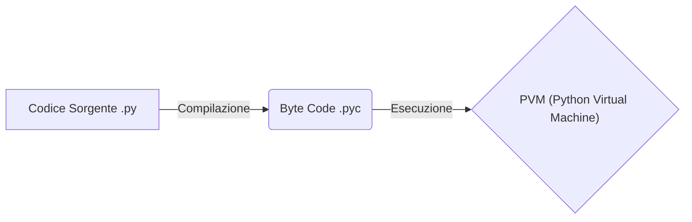
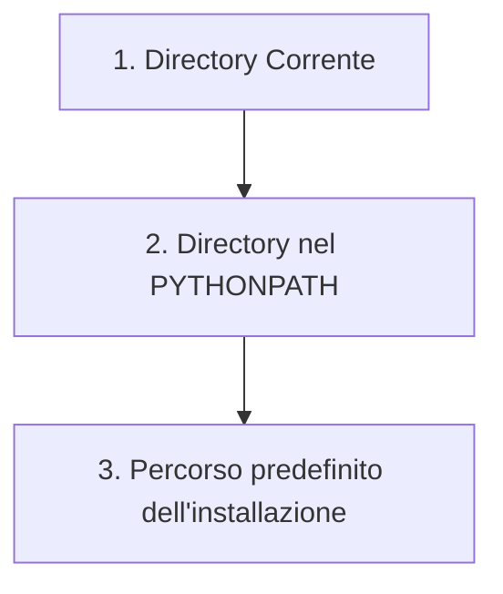
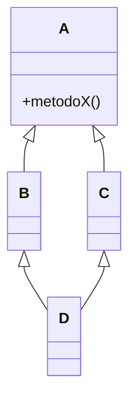
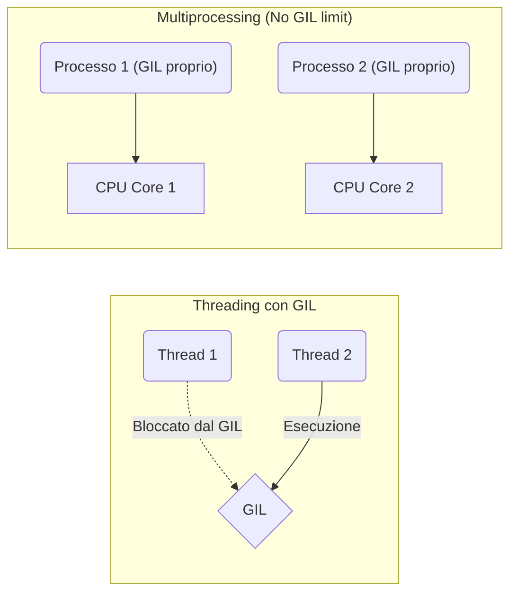

## 1. Introduzione a Python

Python è un linguaggio di programmazione **interpretato**. Il codice non viene tradotto interamente in linguaggio macchina prima dell'esecuzione, ma le singole istruzioni vengono eseguite riga per riga dall'interprete predefinito, **CPython**.

- **Flusso di esecuzione**: CPython traduce il codice sorgente in un _byte code_ (salvato nei file `.pyc`). Questo codice intermedio è generato appositamente per essere letto ed eseguito da una macchina virtuale, la **PVM** (_Python Virtual Machine_).
    

Snippet di codice

- **Data Objects e Tipi**: Python è orientato agli oggetti e manipola i _data objects_. Ogni oggetto ha un tipo, che può essere:
    
    - **Scalare**: indivisibile.
        
    - **Non-scalare**: oggetti con una struttura interna accessibile.
        
- **Le Stringhe**: Sono un tipo di oggetto particolare. Per definizione sono non-scalari (essendo array di caratteri), ma **vengono trattate come scalari**. Poiché sono _immutabili_, non è possibile modificare un singolo carattere di una stringa con una normale assegnazione.
    
- **Funzioni**: Una funzione in Python è composta da: _nome_, _parametri_, _docstring_ (opzionale), _corpo_ e _valore di ritorno_. Se non specificato diversamente, una funzione Python ritorna sempre `None`.
    
- **Scope**: Per _scope_ di una variabile si intende il mapping (l'associazione) tra il nome della variabile e l'oggetto a cui punta nella memoria. Questo mapping può cambiare in base alla funzione attualmente in esecuzione.
    

## 2. Moduli e Package

Le definizioni di funzioni e variabili in Python non vengono salvate alla chiusura dell'interprete. Per mantenere il codice riutilizzabile si usano i **moduli** (normali file `.py`).

- I moduli permettono di eseguire istruzioni come script eseguibili.
    
- Si importano tramite la keyword `import`. Al momento dell'importazione, vengono eseguite tutte le dichiarazioni e definizioni presenti nel modulo.
    

> [!info] La variabile `__main__` Per definire funzionalità di un modulo che **non** devono essere eseguite quando questo viene importato da un altro script, si inserisce il codice nel blocco della variabile globale `if __name__ == '__main__':`. In questo modo le istruzioni verranno eseguite solo se il modulo è avviato direttamente dall'utente.

**Ordine di ricerca dei moduli**: CPython cerca i moduli importati in luoghi specifici e nel seguente ordine:

Snippet di codice

- **Libreria Standard**: Python include moduli nativi per operazioni fondamentali ma non core. Ad esempio, il modulo `sys` tramite la variabile `sys.argv` permette di leggere i parametri passati al programma da riga di comando (es. `python programma.py arg1 arg2`).
    
- **Package**: I moduli sono organizzati in _Packages_ (directory). Ogni directory-package deve contenere un file `__init__.py`. Questo file istruisce l'interprete a trattare la cartella come un package; può essere vuoto o contenere istruzioni di inizializzazione.
    

## 3. Strutture Dati: Tuple, Liste e Dizionari

Le strutture dati principali sono tre:

1. **Tuple `()`**: Sequenza **ordinata** di elementi (anche eterogenei). Sono **immutabili** (non possono cambiare dopo la creazione).
    
2. **Liste `[]`**: Sequenza **ordinata** accessibile tramite indice. Possono contenere elementi eterogenei (sebbene non sia buona norma). Sono **mutabili** (supportano operazioni come `add`, `extend`, `remove`, `sort`, `reverse`).
    
    - **Aliasing vs Slicing**: Assegnando una lista a una nuova variabile (es. `a = b`), si crea un _alias_: ogni modifica si rifletterà su entrambe. Per creare una vera copia indipendente (nuova lista), bisogna usare l'operatore di slicing `[:]` (es. `a = b[:]`).
        
3. **Dizionari `{}`**: Struttura non ordinata basata su coppie **chiave/valore**.
    
    - **Valori**: Possono essere di qualsiasi tipo, possono essere duplicati e persino annidati (es. dizionari di dizionari).
        
    - **Chiavi**: Devono essere **uniche** e **immutabili** (es. stringhe, numeri, tuple).
        

## 4. Parametri e Funzioni

In Python **tutto è un oggetto** e si interagisce tramite i _riferimenti_.

- **Passaggio dei parametri**: Passando un parametro, il riferimento del _parametro attuale_ viene copiato nel _parametro formale_. Se l'oggetto è **mutabile**, ogni modifica fatta al parametro formale nella funzione si rifletterà sull'oggetto originale (parametro attuale).
    
- **Argomenti variabili**:
    
    - `*args`: Permette di passare un numero variabile di argomenti posizionali (deve essere l'ultimo parametro non-keyword nella firma).
        
    - `kwargs`: Permette di passare un numero variabile di _keyword arguments_.
        
- **Keyword arguments**: Il chiamante può esplicitare quale parametro formale sta valorizzando usando il nome del parametro (es. `func(nome="Mario")`).
    

## 5. File ed Eccezioni

### Gestione dei File

All'avvio di un programma Python vengono creati 3 oggetti file per gestire i flussi standard verso il terminale: `sys.stdin`, `sys.stdout` e `sys.stderr`.

- **Costrutto `with`**: Usato per acquisire risorse e rilasciarle automaticamente al termine del blocco (utile per file e lock).
    
- **Funzioni principali**: `open`, `write`, `readlines`, `seek`.
    
- **Modulo `os`**: Permette di interagire col filesystem per creare, rimuovere e rinominare file.
    

### Gestione delle Eccezioni

Quando si verificano condizioni inattese, viene generata un'eccezione.

- Gestione tramite i blocchi: `try` / `except` / `else` / `finally`.
    
- Generazione manuale: Tramite la keyword `raise`.
    
- **Asserzioni**: Utilizzando l'istruzione `assert`, si verifica che una condizione attesa sia vera; in caso contrario, il programma solleva un `AssertionError`.
    
- **Gerarchia**: Ogni eccezione eredita dalla classe `BaseException` (da cui derivano le 4 sottoclassi principali: `SystemExit`, `KeyboardInterrupt`, `GeneratorExit` e `Exception`).
    

## 6. Object-Oriented Programming (OOP)

Python è puramente Object-Oriented: ogni tipo di dato è una classe. Gli oggetti possono essere istanziati, manipolati e distrutti (dal Garbage Collector o esplicitamente).

- **Classi e Metodi**: Si definiscono con la keyword `class`. Variabili e procedure interne prendono il nome di _attributi_ e _metodi_.
    
- **Metodi speciali (Magic Methods)**:
    
    - `__init__`: È il costruttore. Prende come primo parametro `self` (l'istanza stessa della classe).
        
    - `__str__`: Definisce la rappresentazione a stringa dell'oggetto (usata dalla funzione `print()`).
        
    - Altri operatori overridabili: `__add__` (somma), `__eq__` (uguaglianza), ecc.
        
- **Incapsulamento**: Si usano _getter_ e _setter_ per implementare il principio di _information hiding_.
    
- **Metodi e Variabili statiche**: Le variabili statiche sono condivise tra tutte le istanze. I metodi statici possono essere invocati senza istanziare la classe.
    

### Ereditarietà e Diamond Problem

Una _sottoclasse_ eredita attributi e metodi da una _superclasse_. Python supporta l'**ereditarietà multipla**, che introduce il _Diamond Problem_: _Se D eredita sia da B che da C, e sia B che C hanno overridato un metodo di A, quale metodo usa D?_ Python risolve il problema dando priorità in base all'ordine di ereditarietà definito nella firma della classe (algoritmo MRO - Method Resolution Order).

Snippet di codice

_(Nell'esempio sopra, D eredita `metodoX()`. Quale versione eseguirà se B e C lo hanno modificato diversamente? In Python dipende dall'ordine in cui B e C sono dichiarati nella classe D)._

### Polimorfismo e Duck Typing

Il polimorfismo permette di avere metodi omonimi, lasciando all'interprete la scelta a run-time.

- **Duck Typing**: È la tipizzazione dinamica di Python. Sfrutta il _late binding_ e il _dynamic dispatch_ per dedurre il tipo di un oggetto in base ai metodi e alle proprietà che possiede in quel momento (_"Se cammina come un'anatra e fa quack come un'anatra, allora è un'anatra"_).
    

### Classi Astratte e Interfacce

- **Classe Astratta**: Contiene almeno un metodo astratto (solo firma, niente implementazione). Non può essere istanziata, funge da modello.
    
- **Interfaccia**: È una classe astratta in cui _tutti_ i metodi sono astratti.
    
- **Modulo `abc`**: È l'infrastruttura Python per l'astrazione. Le classi devono ereditare da `abc` e usare il decoratore `@abc.abstractmethod` sui metodi.
    
- **Interfacce Informali vs Formali**:
    
    - _Informali_: Sfruttano la natura dinamica di Python; definiscono metodi da overridare ma non obbligano le sottoclassi a farlo.
        
    - _Formali_: Usano il modulo `abc` e i decoratori per obbligare strictamente le sottoclassi a implementare l'overriding.
        

## 7. Programmazione Concorrente

In Python si gestisce tramite due moduli distinti: `threading` e `multiprocessing`.

### Il limite di CPython: Il GIL

Python utilizza il **Global Interpreter Lock (GIL)**: un meccanismo che assicura che **solo un thread alla volta** possa eseguire bytecode. Di conseguenza, il multithreading in Python NON è realmente parallelo, creando un enorme collo di bottiglia per i task _CPU-bound_.

Snippet di codice

### 7.1 Modulo `threading`

Fornisce un'interfaccia di alto livello per il multithreading.

- **Creazione**: Istanziando la classe `Thread` (passando un callable) oppure estendendola e overridando il metodo `run()`. Il thread principale è il _Main Thread_.
    
- **Daemon Threads**: Se contrassegnato come _daemon_, il programma principale non attenderà la sua conclusione per terminare; il thread morirà con il processo padre.
    
- **Classe `local`**: Permette di definire attributi i cui valori sono esclusivi e isolati per il singolo thread in esecuzione, sebbene lo spazio di memoria sia condiviso.
    

**Sincronizzazione dei Thread:**

- **`Lock`**: Ha due stati (_locked_ / _unlocked_). Acquisendolo blocca gli altri thread. Si gestisce con `acquire()`/`release()` o con lo statement `with`.
    
- **`RLock` (Reentrant Lock)**: Può essere acquisito più volte dallo _stesso_ thread senza causare _self-deadlock_. Mantiene in memoria chi l'ha acquisito e un contatore interno delle acquisizioni.
    
- **`Condition` (Condition Variable)**: Condizione su cui i thread restano in attesa. È associata a un Lock. Metodi principali: `wait`, `wait_for`, `notify`, `notify_all`.
    
- **`Semaphore`**: Gestisce un contatore interno (decrementato con acquire, incrementato con release). A zero, blocca i thread chiamanti.
    
- **`Event`**: Meccanismo di comunicazione. Ha un flag interno (Set=True / Clear=False) verificabile con `is_set()` o bloccante con `wait()`.
    

### 7.2 Modulo `multiprocessing`

Aggira il problema del GIL creando processi separati, ognuno col proprio interprete CPython e il proprio GIL indipendente.

**Metodi di avvio processi:**

1. **Spawn** (_Default Windows/MacOS_): Il padre avvia un nuovo _Interpreter Process_. Il figlio eredita solo le risorse strettamente necessarie ed esegue il metodo `run`.
    
2. **Fork** (_Default Linux_): Il figlio eredita tutte le risorse del padre. È considerato **unsafe**: duplica solo il flusso di controllo principale. Se il padre aveva thread figli con lock acquisiti, nel processo figlio questi resteranno bloccati per sempre (causando deadlock) perché i thread figli non vengono duplicati.
    
3. **Forkserver**: Crea un _Server Process_ single-thread. Quando serve, il padre vi si connette e richiede la fork. Essendo single-thread, l'uso di fork qui è **safe** (nessuna eredità di lock pendenti).
    

**Caratteristiche e Condivisione dati:**

- _Nota:_ Il modulo fork esterno `multiprocess` (da non confondere col nativo `multiprocessing`) sostituisce il serializzatore `pickle` con `dill`, permettendo di passare ai processi oggetti più complessi come le funzioni `lambda`.
    
- `multiprocessing` offre le stesse primitive del threading (Lock, RLock, Semaphore, ecc.) ma istanziate tramite la classe `Process`.
    
- **IPC (Inter-Process Communication)**:
    
    - **Pipe**: Connessione tra processi tramite oggetti _Connection_ (estremi del tubo). Si usano `send()` e `recv()`.
        
    - **Queue**: Implementa il pattern Produttore-Consumatore. È una _process shared queue_ basata su Pipe e Lock/Semafori. Usa un thread nascosto per spostare gli oggetti dal buffer alla Pipe.
        
- **Shared Memory**: Si usano oggetti di tipo `Value` o `Array` (compatibili con i tipi di dato del linguaggio C) per la memoria condivisa tra processi.